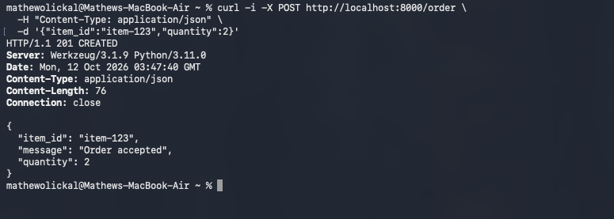
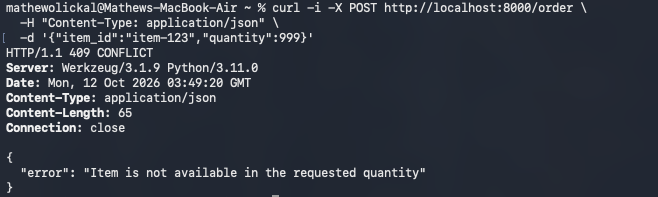
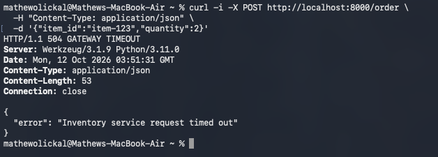
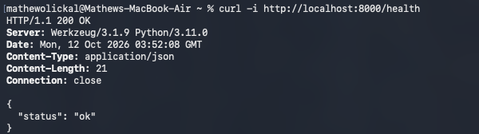

# REST and gRPC Service Interaction

This lab implements the same Order -> Inventory service interaction using both REST/HTTP and gRPC. The Inventory Service contains `item-123` (10 units) and `item-456` (2 units). In both implementations, the Order Service communicates with the Inventory Service to determine whether an order can be accepted. Both Inventory Services also support a temporary delay through `INVENTORY_DELAY_SECONDS` to demonstrate timeout and deadline handling.

## Setup

Create and activate a Python virtual environment:

```bash
python3 -m venv .venv
source .venv/bin/activate
pip install -r requirements.txt
```

The generated gRPC files `inventory_pb2.py` and `inventory_pb2_grpc.py` are included in the repository.

If `inventory.proto` is modified, regenerate them with:

```bash
python -m grpc_tools.protoc -I. \
  --python_out=. --grpc_python_out=. inventory.proto
```

---

## REST Version

### Running the REST Services

Start the REST Inventory Service in one terminal:

```bash
python inventory.py
```

Start the REST Order Service in another terminal:

```bash
python rest.py
```

The Order Service runs on port `8000` and communicates with the Inventory Service at:

```text
http://localhost:5001/inventory/check
```

The Order -> Inventory request uses a two-second timeout.

The Inventory Service URL can be changed using `INVENTORY_SERVICE_URL`, and the timeout can be changed using `INVENTORY_SERVICE_TIMEOUT_SECONDS`.

### Successful REST Request

Send an order for two units of `item-123`:

```bash
curl -i -X POST http://localhost:8000/order \
  -H "Content-Type: application/json" \
  -d '{"item_id":"item-123","quantity":2}'
```

The Order Service returns `201 CREATED` when sufficient inventory is available.



### Unavailable REST Inventory

Request more units than are available:

```bash
curl -i -X POST http://localhost:8000/order \
  -H "Content-Type: application/json" \
  -d '{"item_id":"item-123","quantity":999}'
```

The Order Service returns `409 CONFLICT` because the requested quantity is unavailable.



### REST Timeout Handling

Stop the normal REST Inventory Service and restart it with a delay longer than the Order Service's two-second timeout:

```bash
INVENTORY_DELAY_SECONDS=5 python inventory.py
```

Then send another order:

```bash
curl -i -X POST http://localhost:8000/order \
  -H "Content-Type: application/json" \
  -d '{"item_id":"item-123","quantity":2}'
```

Because the Inventory Service waits five seconds while the Order Service only waits two seconds, the Order Service handles the timeout and returns `504 GATEWAY TIMEOUT`.



### REST Order Service Remains Running

The REST Order Service remains running after the downstream timeout. Without restarting the Order Service, its health endpoint can still be called:

```bash
curl -i http://localhost:8000/health
```

The service responds successfully with `200 OK`.



---

## gRPC Version

The gRPC service contract is defined in [`inventory.proto`](inventory.proto).

### Running the gRPC Services

Start the gRPC Inventory Service:

```bash
python grpc_inventory.py
```

Start the gRPC Order Service in another terminal:

```bash
python grpc_order.py
```

The Inventory Service listens on:

```text
localhost:50051
```

The Order Service listens on:

```text
localhost:50052
```

The Order Service uses a two-second deadline when calling the Inventory Service.

### Successful gRPC Request

Send a valid order using the gRPC client:

```bash
python grpc_client.py item-123 2
```

A successful request returns:

```text
message=Order accepted, item_id=item-123, quantity=2
```


### Unavailable gRPC Inventory

Request more inventory than is available:

```bash
python grpc_client.py item-123 999
```

The Order Service returns the gRPC status `FAILED_PRECONDITION`:

```text
gRPC order failed: FAILED_PRECONDITION: Requested item or quantity is unavailable
```


### gRPC Deadline Handling

Stop only the gRPC Inventory Service and restart it with a five-second delay:

```bash
INVENTORY_DELAY_SECONDS=5 python grpc_inventory.py
```

Keep the gRPC Order Service running and send another request:

```bash
python grpc_client.py item-123 2
```

The Order Service has a two-second deadline for the Inventory call, so the request fails before the delayed Inventory Service responds. The deadline failure is returned using the gRPC `DEADLINE_EXCEEDED` status:

```text
gRPC order failed: DEADLINE_EXCEEDED: Inventory service deadline exceeded
```


### gRPC Order Service Remains Running

The gRPC Order Service is not restarted after the deadline failure.

Stop the delayed Inventory Service and restart only the Inventory Service normally:

```bash
python grpc_inventory.py
```

Using the same running Order Service process, send another request:

```bash
python grpc_client.py item-123 2
```

The request succeeds, demonstrating that the Order Service remained running after the downstream deadline failure.


---

## REST vs. gRPC Comparison

REST used human-readable JSON over HTTP, which made requests easy to test directly using `curl` and HTTP status codes. gRPC required defining the service contract in a `.proto` file and generating Python stubs, but this provided strongly typed request and response messages. REST handled the slow Inventory Service by catching an HTTP client timeout and returning an HTTP `504` response, while gRPC represented the same failure using the `DEADLINE_EXCEEDED` status. The gRPC deadline is attached directly to the RPC call, while the REST timeout is configured by the HTTP client making the request. Both approaches allowed the Order Service to handle a downstream Inventory Service failure without terminating, so it could continue processing requests afterward.
